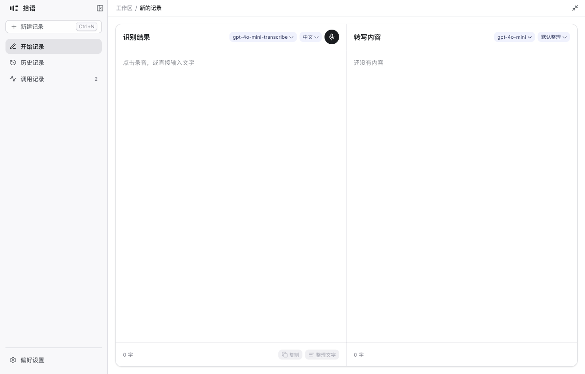

# Shiyu / 拾语

拾语是一个桌面语音输入与文字整理工具。按一次快捷键开始录音，Go 内核直接采集麦克风，ASR 服务把语音转写成文字，再由 OpenAI-compatible 的聊天模型整理、精简并补全标点，最后把结果粘贴到当前光标。配置和历史只保存在本机；支持 macOS、Windows 11 和 Linux，Linux 的 Wayland 环境功能受限。



## 功能

- 全局快捷键或浮动球开始/结束录音，自动粘贴到前台应用。
- ASR 与 LLM 分开配置，各自维护模型池，支持 OpenAI-compatible 服务、Groq、Ollama 和自建网关。
- ASR 支持转写接口与对话接口；对话接口可以在模型级别开启流式返回。
- 整理预设可自定义，内置默认整理、精简去重、Markdown 结构和会议纪要。
- 记录页是双栏工作台：识别原文与整理结果都能直接编辑、复制和重新整理。
- 历史、调用记录、系统托盘，以及隐藏悬浮球后的底部胶囊；浏览器预览无需后端即可调 UI。

## 环境要求

- Go 1.26+
- Node.js 20+
- Wails v3.1+（`make` 会安装固定版本到 `.bin`，不需要全局安装）
- Linux 需要 GTK 3 与 WebKitGTK 4.0/4.1 的开发包；Wails 依赖 cgo，不能直接交叉编译
- macOS 的透明浮动球依赖 Wails 的 `private_mac_apis` 私有 API，只适合直接分发，不能提交 App Store

## 快速开始

```bash
git clone https://github.com/huangypx/shiyu.git
cd shiyu
make install      # 安装前端依赖
make dev          # 桌面开发模式；首次会自动安装 wails3 到 .bin
make build        # 构建桌面应用
make check        # 前端 lint/format/typecheck/test/build + go test
```

只调前端（不启动 Wails 窗口）：

```bash
cd frontend
npm run dev
```

`make build` 会自动追加平台构建标签（macOS `private_mac_apis`，WebKitGTK 4.1 的 `webkit2_41`）。直接调用 `wails3 build` 时需要自己加。

## 配置模型

在「偏好设置」中分别填写 ASR 和 LLM。接口地址可以填服务商根地址（例如 `https://api.openai.com/v1`），也可以直接填完整端点；后端会自动补齐 OpenAI-compatible 路径。

ASR 有两种接口类型：

| 接口类型 | 请求 | 适用 |
| --- | --- | --- |
| 转写接口（默认） | multipart 上传到 `/audio/transcriptions` | OpenAI、Groq、whisper.cpp 等 Whisper 兼容服务 |
| 对话接口 | JSON 上传到 `/chat/completions`，音频作为 `input_audio` | 多模态语音模型 |

对话接口可以在模型级别开启 `stream`，服务商以 SSE 边生成边返回文字；音频仍然整段上传一次。整理预设由「名称 + 系统提示词」组成，可以新建、复制、编辑和切换，提示词里的 `{{language}}` 会替换成当前识别语言。LLM 使用 `choices[0].message.content`；本地 Ollama 可将地址设为 `http://127.0.0.1:11434/v1`，API key 留空。

直接填写的 API key 会写进 `~/.shiyu/config.json`（目录 0700、文件 0600）；也可以写成 `env:OPENAI_API_KEY` 或 `file:/绝对路径`，把明文密钥留在配置文件之外。应用不会把 key、音频或完整请求体写入日志和历史。

## 使用

默认快捷键按平台区分：macOS `Option+Space`、Windows `Alt+Space`、Linux `Ctrl+Shift+Space`。macOS/Windows 的快捷键由 Go 全局注册；Linux X11 可选 `xbindkeys`，Wayland 或缺少依赖时回退到窗口内快捷键。注册失败时设置页会显示原因。

录音结束后默认执行「转写 → 整理 → 粘贴到触发录音前的光标」。如果系统没有可用的 `wtype`、`xdotool`、`osascript` 或 PowerShell 注入器，结果仍会留在剪贴板，可手动粘贴。

- 主窗口右上角的斜向箭头把窗口收成置顶浮动球；单击开始/结束录音，悬停显示展开和设置，录音/整理时只显示取消。
- 在 macOS/Windows 上，把主窗口收进悬浮球或隐藏悬浮球后可从系统托盘恢复；Linux 没有托盘实现，不能持久化隐藏悬浮球。
- 隐藏悬浮球后，全局快捷键会在屏幕底部显示不抢焦点的胶囊；录音、整理和取消都在这里完成。
- 历史记录保存在 SQLite，可删除单条、清空或按保留期在启动时清理；调用记录只保存在本次运行的内存中。

macOS 首次录音会请求麦克风权限；首次自动粘贴会请求控制 System Events 的自动化权限，拒绝后仍会把结果留在剪贴板。

## 项目结构

```text
backend/   配置、provider 客户端、ASR/LLM 调用、历史与调用指标
desktop/   窗口、托盘、全局热键、麦克风采集、粘贴注入
frontend/  React + Vite 界面；Wails 生成的 TypeScript 绑定在 frontend/bindings/
build/     Wails 构建配置与各平台打包资源
docs/      架构与本地存储说明
main.go    Wails 入口与嵌入式前端资源
```

更细的调用链与窗口模型见 [`docs/architecture.md`](docs/architecture.md)；配置和历史库的持久化契约见 [`docs/storage.md`](docs/storage.md)。

## 开发与贡献

欢迎提交 issue 和 pull request。提交前请确认 `gofmt -l .` 无输出、`make check` 通过；提交信息使用英文 Conventional Commits，一个 PR 只做一件事，UI 变更请附截图。使用 AI Agent 参与开发时，请先阅读 [`AGENTS.md`](AGENTS.md)。

## 许可证

[MIT](LICENSE)
