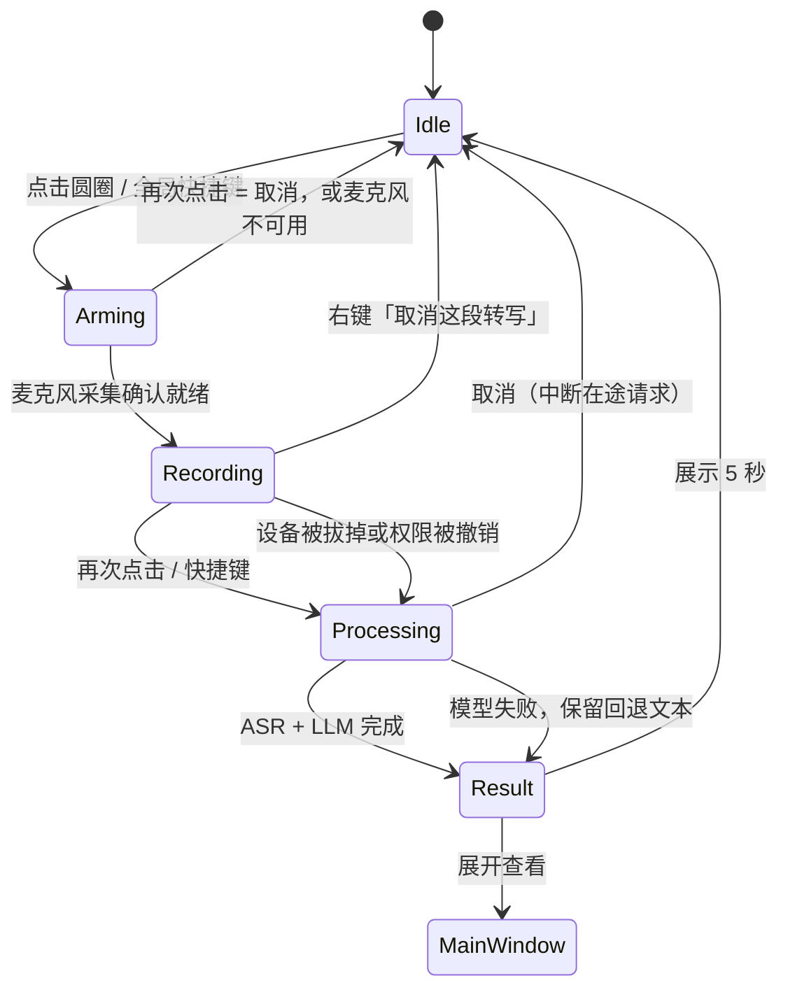

# 桌面交互设计

桌面端把“录音入口”和“结果编辑器”分开：浮动圆圈负责低打扰地开始/结束录音，主窗口负责检查、改写和管理历史。这样用户在编辑器或聊天窗口工作时不必反复切回完整窗口，同时保留对自动输入的控制权。

## 窗口层

主窗口和浮动圆圈共用同一个 Wails 窗口，但窗口层按平台使用不同的原生能力：

- **macOS** 使用 `MacTitleBarHidden` 保留原生交通灯。标题栏给交通灯预留空间。切到浮动模式时，cgo 适配器将 `styleMask` 改为无边框并关闭阴影，展开时恢复。透明 WKWebView 依赖 `private_mac_apis` 构建标签。
- **Windows 11 / Linux** 使用无边框窗口。标题栏左端是拾语标记，右端是最小化、最大化和关闭按钮。双击空白处可最大化或还原。Windows 进入浮动模式时收起玻璃边框，输入焦点留在原应用。

Wails 只提供窗口层原生能力；网页里的按钮、输入框和图标仍是 HTML/CSS，不会变成 NSButton 或 Win32 控件。真正需要 100% 原生控件时，应改用 SwiftUI/WinUI，或做原生外壳。

## 状态流

每个状态都同时通过文案、图标和按钮状态表达。快捷键触发的是同一条录音流程，不另起一套业务逻辑，因此窗口内点击和后台快捷键不会产生不同结果。

**录音必须在麦克风就绪之后才开始。** 点击后先进入「开启麦克风」：`services/recorder.ts` 先拿到 `getUserMedia` 的音频流，等第一次 `onaudioprocess` 真正送出音频（兜底 400ms 且确认已收到数据）之后，`WavRecorder.ready` 才 resolve，界面这时才切到录音态。后端的 `StartRecording` 只是内存记账，改为不阻塞地调用，不会再让一次 Wails 往返把第一句话挡在门外。因此在 Arming 阶段反复点击是取消，不会留下一个偷偷运行的采集器；权限被拒、没有设备、设备被占用都停在 Idle 并给出可读原因。

浮动胶囊通过 `subscribeMicLevel` 订阅麦克风电平，波形随声音变化。

## 两种窗口模式

- **主窗口**左侧是可编辑的原文，右侧是可复制的整理结果。工具栏提供录音、新建、历史和设置，通过「更多操作」可进入调用记录或收进悬浮球。重新展开时，主窗口恢复原先的位置和大小。
- **浮动模式**在空闲时隐藏窗口。录音、通知与整理结果共用屏幕下方的悬浮球，内容变宽或变高时向屏幕工作区内展开。

切换到其他应用或最小化时，拾语自动进入后台。Windows 任务栏隐藏拾语窗口。关闭窗口默认询问「后台运行」或「直接退出」，可以勾选记住本次选择。「偏好设置 → 桌面行为 → 关闭窗口时」可恢复每次询问。

### 浮动圆圈的手势

| 手势 | 行为 |
| --- | --- |
| 单击 | 在通知或结果旁点麦克风开始录音，点停止按钮结束录音，点复制图标复制结果全文 |
| 双击通知或结果旁的麦克风图标 | 展开主窗口 |
| 拖动麦克风图标 | 移动窗口，位置写入 `desktop.bubblePosition`，重启后还原 |
| 右键 | 上下文菜单：展开主窗口、取消这段转写、打开偏好设置、隐藏悬浮球、退出拾语 |

右键菜单是 Wails v3 的原生 context menu：`desktop/menu.go` 把菜单注册到 `app.ContextMenu`，圆圈的按钮元素通过 CSS 自定义属性 `--custom-contextmenu: bubble-menu` 绑定它。菜单在鼠标指针处弹出，由系统处理屏幕边缘翻转、Esc 和点击外部关闭。菜单使用独立的原生弹层。

拖动使用 Wails 的原生拖拽区（`--wails-draggable: drag`）：指针移出浮动窗口后仍由系统拖拽循环跟踪，快速拖动不会丢事件；早期用 JS 位移驱动窗口的方案在快速拖动时会让光标跑出窗口，事件随即中断。代价是拖拽区会吞掉 `click`，所以点击改由 `mouseup` 判定：按下到抬起短于 400ms 且位移小于 4px 才算点击，位移更大则视为一次拖拽结束并保存位置。

macOS 上还额外放行了「首击」：`desktop/firstmouse_darwin.go` 给 `WKWebView` 加了 `acceptsFirstMouse:` 覆盖。否则应用不在前台时，第一次点击只会用来激活窗口，事件根本到不了网页，悬浮球会表现为「点不动、也拖不动」。

录音时，悬浮球展开为横向胶囊，只显示随音量变化的波形与停止图标。转写和整理共用一个进度图标。完成后胶囊显示正文和复制图标，长文本可滚动，点击复制取全文。结果与通知各自显示 5 秒，录音期间持续可见。

## 取消与流式返回

主窗口工具栏和浮动圆圈右键菜单都能取消正在进行的录音或转写。原生菜单通过 `Controller.SetTranscribing` 同步可用状态，点击后发出 `desktop:cancel-transcribe` 事件，由前端结束本次会话。

取消的语义按状态区分：

| 状态 | 取消后 |
| --- | --- |
| 开启麦克风 | 关掉采集器，回到 Idle，与再次点击一样 |
| 录音中 | 丢弃已经采集的音频，**不产生任何 ASR / LLM 调用**，不写历史，清空草稿 |
| 处理中 | 后端 `CancelTranscription` 中断在途 HTTP 请求（转写或整理），结果与历史一并丢弃，界面立刻回到 Idle |

实现上用一个递增的「处理代号」而不是布尔标记：取消时代号 +1，所有 `await` 之后都会核对代号，对不上的结果、以及之后才到达的流式增量文本都直接丢掉。被取消的请求通常以连接中断收尾，这种错误同样静默处理，不会弹「转写失败」。

**流式返回**是每个 ASR 模型的独立开关（`asr.models[].stream`），只在对话接口下生效。开着它时，录音结束后仍是整段音频上传一次，只是服务商以 SSE 边生成边返回，界面逐字上屏；关掉就是等整段结果一次性出现。两者的最终文本逐字相同，因为被识别的内容完全是同一段音频。网关忽略 `stream` 直接回 JSON 时会自动回落，开关不会「开了就坏」。它不等于「边说边出字」：那需要流式输入，而小米没有提供。

## 自动输入策略

浮动录音开始时记下可编辑控件的标识，在整理完成时复核。Windows 查询 UI Automation，macOS 使用已有的辅助功能授权，Linux 可通过系统的 `pyatspi` 查询。没有确认到同一个输入框时，全文留在浮动球里，点击复制图标才写入剪贴板。

有输入目标并开启自动粘贴时，应用会复核焦点并发送粘贴键。胶囊在文字整理完成时即可复制全文，自动粘贴成功也保留这份预览。主窗口仍使用原有的自动输入流程。

用户可以关闭自动粘贴。开启“粘贴后恢复原剪贴板”时，原内容在约 1.5 秒后恢复；关闭时，最后生成的文本会继续留在剪贴板，适合连续复制多条结果。

## 结果历史

主窗口的历史列表显示标题和短预览。点开记录可查看完整整理结果和转写原文。录音在前台或后台完成都会写入本机历史，默认永久保留，可在「偏好设置 → 桌面行为」调整保留期。

## 快捷键能力

Windows 默认使用物理右 Alt 键，按一次开始录音，再按一次结束。macOS 和 Linux 默认使用 `Ctrl+Shift+Space`。用户可在「偏好设置 → 桌面行为」更换快捷键。后台触发录音时通过悬浮球反馈，输入焦点留在原应用。
