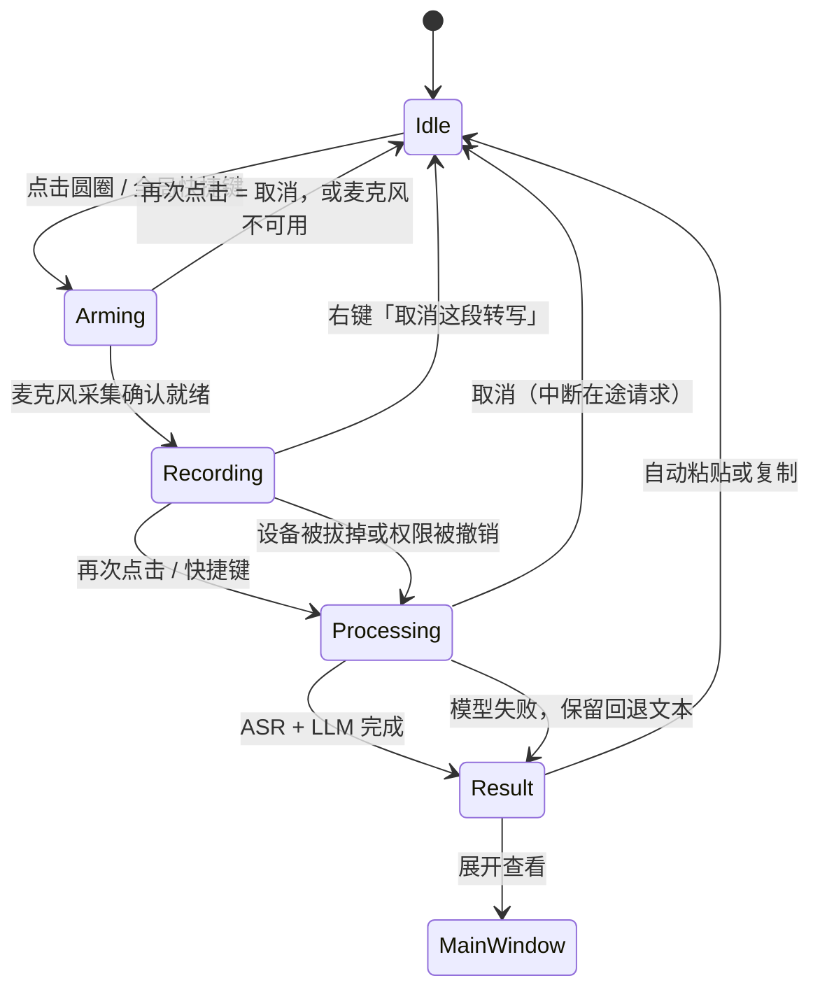

# 桌面交互设计

桌面端把“录音入口”和“结果编辑器”分开：浮动圆圈负责低打扰地开始/结束录音，主窗口负责检查、改写和管理历史。这样用户在编辑器或聊天窗口工作时不必反复切回完整窗口，同时保留对自动输入的控制权。

## 窗口层

主窗口和浮动圆圈共用同一个 Wails 窗口，但窗口层按平台使用不同的原生能力：

- **macOS**：主窗口是 titled window，使用 `MacTitleBarHidden` 保留真实的红黄绿交通灯，并把标题栏设为透明、全尺寸内容。交通灯不再单独占一行：它们直接落在 36px 的应用顶带里，左侧让出的 78px 由顶带自己预留（展开时是侧栏头部，收起后由顶栏接管），因此品牌、面包屑、窗口操作和交通灯同处一条水平线。切到 92×92 浮动模式时，cgo 适配器把 `styleMask` 临时切为 borderless 并关闭窗口阴影；展开时恢复进入浮动模式前的 titled mask，因此交通灯、透明标题栏和阴影都会回来。透明 WKWebView 依赖 `private_mac_apis` 构建标签。
- **Windows 11 / Linux**：窗口保持 frameless（92×92 悬浮球依赖这一点），使用透明 webview，并且和 macOS 一样只有一条 36px 顶带：左端是侧栏头部（品牌 + 收起按钮），右端是 HTML 绘制的最小化/最大化/关闭（Windows 46px 宽、Linux 36px 宽，只有关闭键 hover 变红）。不再另起一行 caption，窗口标题只在侧栏头部出现一次；按钮的点击语义、hover 颜色由前端决定，窗口本身仍是 Wails 的原生窗口。Windows 上还有一个只在浮动模式出现的细节：Wails 默认把 1px 玻璃边框扩进客户区（Aero 阴影与 Win11 圆角都来自它），92px 的球窗因此会露出一圈浅色描边和一层变暗的方框；`desktop/chrome_windows.go` 在切到浮动模式时把扩框收回（边距 0），并在 `WM_ACTIVATE` 之后重压一次，展开时恢复 1px。画布由 AppShell 的 CSS 绘制，不安装 Mica/GTK 原生材质视图。

Wails 只提供窗口层原生能力；网页里的按钮、输入框和图标仍是 HTML/CSS，不会变成 NSButton 或 Win32 控件。真正需要 100% 原生控件时，应改用 SwiftUI/WinUI，或做原生外壳。

## 状态流

每个状态都同时通过文案、图标和按钮状态表达。快捷键触发的是同一条录音流程，不另起一套业务逻辑，因此窗口内点击和后台快捷键不会产生不同结果。

**录音必须在麦克风就绪之后才开始。** 点击后先进入「开启麦克风」：`services/recorder.ts` 先拿到 `getUserMedia` 的音频流，等第一次 `onaudioprocess` 真正送出音频（兜底 400ms 且确认已收到数据）之后，`WavRecorder.ready` 才 resolve，界面这时才切到录音态。后端的 `StartRecording` 只是内存记账，改为不阻塞地调用，不会再让一次 Wails 往返把第一句话挡在门外。因此在 Arming 阶段反复点击是取消，不会留下一个偷偷运行的采集器；权限被拒、没有设备、设备被占用都停在 Idle 并给出可读原因。

主窗口的录音卡与浮动圆圈共用同一条音量订阅 `subscribeMicLevel`（0–1 的归一化电平，从 RMS 经噪声门与起音/回落平滑得到）。音量只通过 CSS 变量 `--mic-level` 写进 DOM，不进入 React 状态，几十赫兹的更新不会触发重渲染。

## 两种窗口模式

- **主窗口**：展示一张可翻转的记录卡（原始转写 ⇄ 整理结果）和历史记录。左侧导航固定，只有右侧内容区滚动；顶部是一条 36px 的顶带（macOS 的交通灯就在这一行，Windows/Linux 的窗口按钮落在同一行的右端），右上角的浮动按钮将窗口缩成 92×92 的圆形入口。侧栏可以用顶带右侧的按钮或 ⌘\（Windows/Linux 显示为 Ctrl+\）收起，收起后顶带左侧变成「展开侧栏 + 新建记录」，交通灯的让位随之转交给顶栏。
- **浮动模式**：窗口是一个 92×92 的透明方框，只画出圆形按钮，窗口本身保持置顶（可关闭）。浮动模式下不会展示模型配置或长文本，避免遮挡当前应用。

### 浮动圆圈的手势

| 手势 | 行为 |
| --- | --- |
| 单击 | 开始/结束录音。双击判定需要 260ms，所以单击会延迟到双击窗口结束后再触发 |
| 双击 | 展开主窗口 |
| 拖动 | 移动窗口。整个圆圈都可以拖动，位置写入 `desktop.bubblePosition`，重启后还原 |
| 右键 | 上下文菜单：展开主窗口、取消这段转写、打开偏好设置、隐藏悬浮球、退出拾语 |

右键菜单是 Wails v3 的原生 context menu：`desktop/menu.go` 把菜单注册到 `app.ContextMenu`，圆圈的按钮元素通过 CSS 自定义属性 `--custom-contextmenu: bubble-menu` 绑定它。菜单在鼠标指针处弹出，由系统处理屏幕边缘翻转、Esc 和点击外部关闭。窗口始终保持 92×92，不再为菜单放大，也没有自绘菜单的几何计算。

拖动使用 Wails 的原生拖拽区（`--wails-draggable: drag`）：指针移出 92×92 的窗口后仍由系统拖拽循环跟踪，快速拖动不会丢事件；早期用 JS 位移驱动窗口的方案在快速拖动时会让光标跑出窗口，事件随即中断。代价是拖拽区会吞掉 `click`，所以点击改由 `mouseup` 判定：按下到抬起短于 400ms 且位移小于 4px 才算点击，位移更大则视为一次拖拽结束并保存位置。

macOS 上还额外放行了「首击」：`desktop/firstmouse_darwin.go` 给 `WKWebView` 加了 `acceptsFirstMouse:` 覆盖。否则应用不在前台时，第一次点击只会用来激活窗口，事件根本到不了网页，悬浮球会表现为「点不动、也拖不动」。

圆圈的状态只用颜色、图标和尺寸表达：石墨色麦克风表示待录音，麦克风外圈的呼吸环表示正在开启麦克风（此时球体不缩放，说明还没开始收音），红色方块表示录音中且球体会随说话音量放大到最多约 1.12 倍并带一圈音晕，旋转图标表示整理中；完成后按钮会短暂闪光，因为 92×92 的窗口放不下 Toast。静止时球保持 72px，放大后加外圈仍在 92×92 窗口内，不会被窗口边界裁掉。系统开启「减少动态效果」时缩放幅度降到几乎不可见，音量改由音晕透明度表达。

## 取消与流式返回

**取消这段转写**在两个地方可用：浮动圆圈的右键菜单，以及主窗口录音卡里的同名文字按钮。菜单项由 `Controller.SetTranscribing` 控制可用性——React 侧在状态离开 `idle` 时把它点亮，回到 `idle` 时置灰；Wails 的原生菜单每次弹出前会按当前状态重建，因此改完下一次右键就生效。菜单点击在 Go 侧只发出 `desktop:cancel-transcribe` 事件，真正的录音状态由 React 持有。

取消的语义按状态区分：

| 状态 | 取消后 |
| --- | --- |
| 开启麦克风 | 关掉采集器，回到 Idle，与再次点击一样 |
| 录音中 | 丢弃已经采集的音频，**不产生任何 ASR / LLM 调用**，不写历史，清空草稿 |
| 处理中 | 后端 `CancelTranscription` 中断在途 HTTP 请求（转写或整理），结果与历史一并丢弃，界面立刻回到 Idle |

实现上用一个递增的「处理代号」而不是布尔标记：取消时代号 +1，所有 `await` 之后都会核对代号，对不上的结果、以及之后才到达的流式增量文本都直接丢掉。被取消的请求通常以连接中断收尾，这种错误同样静默处理，不会弹「转写失败」。

**流式返回**是每个 ASR 模型的独立开关（`asr.models[].stream`），只在对话接口下生效。开着它时，录音结束后仍是整段音频上传一次，只是服务商以 SSE 边生成边返回，界面逐字上屏；关掉就是等整段结果一次性出现。两者的最终文本逐字相同，因为被识别的内容完全是同一段音频。网关忽略 `stream` 直接回 JSON 时会自动回落，开关不会「开了就坏」。它不等于「边说边出字」：那需要流式输入，而小米没有提供。

## 自动输入策略

整理完成后默认执行“写入剪贴板 → 发送粘贴键”。如果系统没有可用的 `wtype`、`xdotool`、`osascript` 或 PowerShell 注入器，应用不会丢失文本：它会保留剪贴板内容并提示用户手动粘贴。

用户可以关闭自动粘贴。开启“粘贴后恢复原剪贴板”时，原内容在约 1.5 秒后恢复；关闭时，最后生成的文本会继续留在剪贴板，适合连续复制多条结果。

## 结果历史

历史列表只显示标题和短预览，点击一条后展开完整整理结果。展开项提供“复制结果”和“粘贴到当前光标”两个动作，打开到编辑器后记录卡直接落在整理结果一面，原文在另一面，随时可以翻回去继续编辑。历史数量受设置中的上限约束，默认保留 20 条。

## 快捷键能力

默认快捷键是 `Ctrl+Shift+Space`，设置面板可修改。桌面端在 Linux X11 上通过可选的 `xbindkeys` 注册全局快捷键；Wayland 或缺少依赖时显示明确原因，并继续支持窗口内快捷键。该降级路径让功能在不同桌面环境下仍然可用，而不会静默吞掉用户按键。
