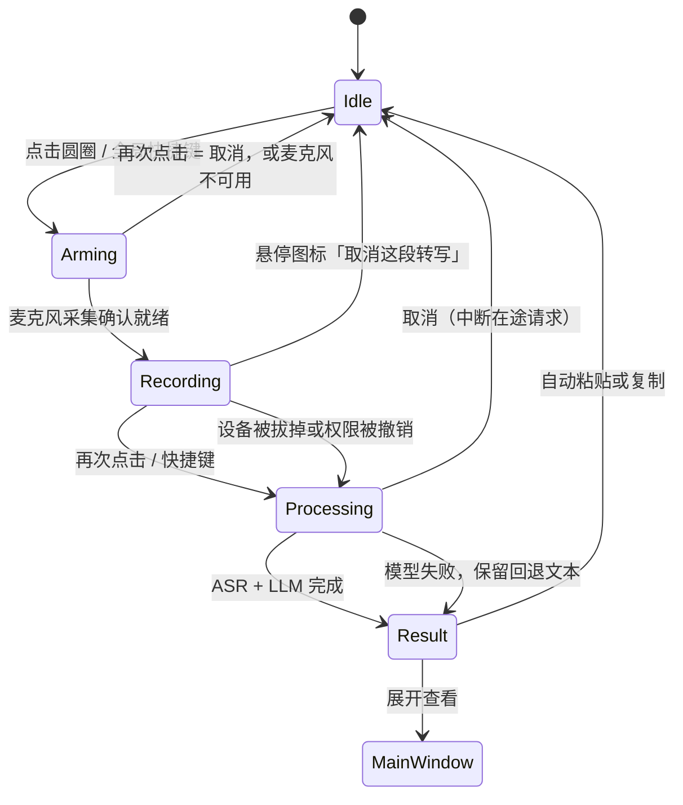

# 桌面交互设计

桌面端把“录音入口”和“结果编辑器”分开：浮动圆圈负责低打扰地开始/结束录音，主窗口负责检查、改写和管理历史。这样用户在编辑器或聊天窗口工作时不必反复切回完整窗口，同时保留对自动输入的控制权。

## 窗口层

主窗口和浮动圆圈共用同一个 Wails 窗口，但窗口层按平台使用不同的原生能力：

- **macOS**：主窗口是 titled window，使用 `MacTitleBarHidden` 保留真实的红黄绿交通灯，并把标题栏设为透明、全尺寸内容。交通灯不再单独占一行：它们直接落在 36px 的应用顶带里，左侧让出的 78px 由顶带自己预留（展开时是侧栏头部，收起后由顶栏接管），因此品牌、面包屑、窗口操作和交通灯同处一条水平线。切到 92×126 浮动模式时，cgo 适配器把 `styleMask` 临时切为 borderless 并关闭窗口阴影；展开时恢复进入浮动模式前的 titled mask，因此交通灯、透明标题栏和阴影都会回来。透明 WKWebView 依赖 `private_mac_apis` 构建标签。
- **Windows 11 / Linux**：窗口保持 frameless（悬浮球窗口依赖这一点），使用透明 webview，并且和 macOS 一样只有一条 36px 顶带：左端是侧栏头部（品牌 + 收起按钮），右端是 HTML 绘制的最小化/最大化/关闭（Windows 46px 宽、Linux 36px 宽，只有关闭键 hover 变红）。不再另起一行 caption，窗口标题只在侧栏头部出现一次；按钮的点击语义、hover 颜色由前端决定，窗口本身仍是 Wails 的原生窗口。Windows 上还有一个只在浮动模式出现的细节：Wails 默认把 1px 玻璃边框扩进客户区（Aero 阴影与 Win11 圆角都来自它），92px 宽的球窗因此会露出一圈浅色描边和一层变暗的方框；`desktop/chrome_windows.go` 在切到浮动模式时把扩框收回（边距 0），并在 `WM_ACTIVATE` 之后重压一次，展开时恢复 1px。画布由 AppShell 的 CSS 绘制，不安装 Mica/GTK 原生材质视图。

Wails 只提供窗口层原生能力；网页里的按钮、输入框和图标仍是 HTML/CSS，不会变成 NSButton 或 Win32 控件。真正需要 100% 原生控件时，应改用 SwiftUI/WinUI，或做原生外壳。

## 状态流

每个状态都同时通过文案、图标和按钮状态表达。快捷键触发的是同一条录音流程，不另起一套业务逻辑，因此窗口内点击和后台快捷键不会产生不同结果。

**录音必须在麦克风就绪之后才开始。** 点击后先进入「开启麦克风」：`services/recorder.ts` 先拿到 `getUserMedia` 的音频流，等第一次 `onaudioprocess` 真正送出音频（兜底 400ms 且确认已收到数据）之后，`WavRecorder.ready` 才 resolve，界面这时才切到录音态。后端的 `StartRecording` 只是内存记账，改为不阻塞地调用，不会再让一次 Wails 往返把第一句话挡在门外。因此在 Arming 阶段反复点击是取消，不会留下一个偷偷运行的采集器；权限被拒、没有设备、设备被占用都停在 Idle 并给出可读原因。

主窗口的录音卡与浮动圆圈共用同一条音量订阅 `subscribeMicLevel`（0–1 的归一化电平，从 RMS 经噪声门与起音/回落平滑得到）。音量只通过 CSS 变量 `--mic-level` 写进 DOM，不进入 React 状态，几十赫兹的更新不会触发重渲染。

## 三种窗口形态

- **主窗口**：展示一张可翻转的记录卡（原始转写 ⇄ 整理结果）和历史记录。左侧导航固定，只有右侧内容区滚动；顶部是一条 36px 的顶带（macOS 的交通灯就在这一行，Windows/Linux 的窗口按钮落在同一行的右端），右上角的浮动按钮将窗口缩成 92×126 的浮动窗口（顶部 92×92 是圆圈）。侧栏可以用顶带右侧的按钮或 ⌘\（Windows/Linux 显示为 Ctrl+\）收起，收起后顶带左侧变成「展开侧栏 + 新建记录」，交通灯的让位随之转交给顶栏。
- **浮动模式**：窗口是一个 92×126 的透明方框：顶部 92×92 画圆形按钮，底部 34px 留给悬停时出现的工具栏；窗口本身保持置顶（可关闭）。浮动模式下不会展示模型配置或长文本，避免遮挡当前应用。
- **底部胶囊（overlay）**：隐藏悬浮球后按全局快捷键出现的第三形态。原生窗口固定 360×72，停在当前屏幕工作区底部居中（下边距 48px），强制置顶、透明、无边框，复用浮动球的 chrome 适配器。窗口内画一枚 320×56 的石墨胶囊：左侧波形、右侧取消按钮；录音结束后胶囊在窗口内用 CSS 收缩成 56×56 的圆并显示旋转图标，原生窗口尺寸不变，避免与收起/展开动画抢 frame。胶囊形态**全程不抢占焦点**：自动粘贴的目标是按下快捷键那一刻的前台应用，overlay 一旦 Focus 就会把粘贴送进自己。进出 overlay 都走无动画路径（`applyModeImmediately`），不发 `desktop:transition`，水滴遮罩不参与。

### 浮动圆圈的手势

| 手势 | 行为 |
| --- | --- |
| 单击 | 开始/结束录音，立即生效（不再等待双击判定） |
| 悬停 | 圆圈下方淡出操作按钮：待录音时是展开主窗口和打开偏好设置；开始录音后只保留取消这段转写，移出后淡出 |
| 拖动 | 移动窗口。整个圆圈都可以拖动，位置写入 `desktop.bubblePosition`，重启后还原 |
| 右键 | 上下文菜单：隐藏悬浮球、退出拾语 |

右键菜单是 Wails v3 的原生 context menu：`desktop/menu.go` 把菜单注册到 `app.ContextMenu`，圆圈的按钮元素通过 CSS 自定义属性 `--custom-contextmenu: bubble-menu` 绑定它。菜单只保留「隐藏悬浮球」「退出拾语」，展开、取消和设置都在悬停工具栏里；菜单在鼠标指针处弹出，由系统处理屏幕边缘翻转、Esc 和点击外部关闭。「隐藏悬浮球」是持久化动作：走 `Controller.SetBubbleHidden(true)` 写入 `desktop.bubbleHidden`，重启后仍只剩托盘；Linux 没有托盘实现，该菜单项退回临时 `HideWindow()`，不写配置。

悬停工具栏由 React 绘制，按钮都是普通 HTML 按钮；待录音时显示展开和设置，进入录音/整理后只剩取消。窗口固定 92×126，底部 34px 是透明的工具栏条，悬停时不再改原生窗口尺寸。指针落在某个按钮上时，按钮底色反转为 `--gray-1`、图标变为 `--gray-12`：深色主题是黑底白图标，浅色主题是白底黑图标，当前悬停的是哪一个动作一眼可见。同一 tracking area 在鼠标移动时以约 20Hz 把窗口坐标送进 `window.__shiyuBubblePointer`，页面用 `elementFromPoint` 命中 `[data-bubble-action]` 并加上 `data-hovered`；指针跟踪只在浮动模式开启，主窗口不会收到这些调用。macOS 的 WebKit 只在 key window 里更新 CSS `:hover`，而浮动球通常处在后台；`desktop/hover_darwin.go` 给 WKWebView 挂了一个 `NSTrackingActiveAlways` 的 tracking area，进入/离开时调用 `window.__shiyuBubbleHover(true/false)`，React 只改 shell 上的 `data-hover` 属性，不触发重渲染。工具栏同时接受 `:hover`、`:focus-within` 和 `data-hover`，键盘聚焦到球时也能出现。球下方的工具栏条始终属于窗口，因此会挡住对下层应用的一小块点击；这是固定加高换取稳定悬停的取舍。

菜单会话期间拖拽区会临时切到 `--wails-draggable: no-drag`。macOS 的原生菜单跟踪会吞掉关闭菜单那一下的按下/抬起配对，菜单关闭后页面可能只收到带着左键状态的移动事件；Wails 的原生拖拽会把这种「看不到按下、只看得到移动」的事件合成一次拖拽，并用上一次 `NSMouseDown` 作为锚点，窗口就会被挪到指针处。组件从 `contextmenu` 起保持 `no-drag`，直到出现一次能证明左键已经抬起的鼠标事件（或窗口失焦）；关闭菜单的那一下点击也不会被当成录音开关。

拖动使用 Wails 的原生拖拽区（`--wails-draggable: drag`）：指针移出 92×126 的窗口后仍由系统拖拽循环跟踪，快速拖动不会丢事件；早期用 JS 位移驱动窗口的方案在快速拖动时会让光标跑出窗口，事件随即中断。工具栏条单独设为 `no-drag`，从按钮或透明条按下都不会拖动窗口。代价是拖拽区会吞掉 `click`，所以点击改由 `mouseup` 判定：按下到抬起短于 400ms 且位移小于 4px 才算点击，位移更大则视为一次拖拽结束并保存位置。

macOS 上还额外放行了「首击」：`desktop/firstmouse_darwin.go` 给 `WKWebView` 加了 `acceptsFirstMouse:` 覆盖。否则应用不在前台时，第一次点击只会用来激活窗口，事件根本到不了网页，悬浮球会表现为「点不动、也拖不动」。

### 收起与展开

右上角的动作按钮把主窗口收进浮动圆圈。收起前先记下主窗口的 frame（位置和尺寸），再让主界面在 140ms 内淡出；原生窗口 160ms 后才开始向悬浮球收缩，所以窗口尺寸变化时内容已经不可见，不会闪出滚动条或响应式重排。收缩的目标是 `desktop.bubblePosition` 记住的球位置，球的屏幕坐标在收缩期间保持不动。

展开时不再把悬浮球拖到屏幕左上角再放大。点击悬停工具栏的展开图标后圆圈在原位淡出并缩到 0.86，160ms 后原生窗口直接落回收起前记住的 frame；主界面用 200ms 从 0.96 倍淡入，覆盖窗口的画布遮罩同时淡出。窗口没有逐帧移动，用户看到的是主窗口在原来的位置出现，悬浮球则在自己的位置消失。这样悬浮球的位置和主窗口的位置互不影响：球可以拖到任意角落，展开仍回到主窗口收起前的位置。

收起前的主窗口 frame 只保存在内存里；应用重启后没有记录时回退到当前屏幕居中。`prefers-reduced-motion` 下两条路径都跳过逐帧动画，直接落定。

圆圈的状态只用颜色、图标和尺寸表达：石墨色麦克风表示待录音，麦克风外圈的呼吸环表示正在开启麦克风（此时球体不缩放，说明还没开始收音），红色方块表示录音中且球体会随说话音量放大到最多约 1.12 倍并带一圈音晕，旋转图标表示整理中；完成后按钮会短暂闪光，因为 92px 宽的浮动窗放不下 Toast。静止时球保持 72px，放大后加外圈仍在顶部的 92×92 球区内，不会被窗口边界裁掉；工具栏在球下方，不参与音量缩放。系统开启「减少动态效果」时缩放幅度降到几乎不可见，音量改由音晕透明度表达。

## 托盘与隐藏悬浮球

系统托盘图标常驻：无论悬浮球是否隐藏，macOS 菜单栏与 Windows 右下角都有拾语图标。托盘由 `desktop/tray.go` 在 `ServiceStartup` 里通过 `app.SystemTray.New()` 装配（不手动调用 `Run()`，由 Wails 在应用运行后补跑），退出时 `Destroy()`。因为托盘常驻，关闭主窗口不再退出进程（`ApplicationShouldTerminateAfterLastWindowClosed: false`），退出只走托盘菜单或悬浮球右键菜单的「退出拾语」。

托盘菜单四项：「显示悬浮球」「隐藏悬浮球」（按当前可见性互斥禁用）、「打开主窗口」、分隔、「退出拾语」。左键单击行为按平台区分：macOS 打开菜单（符合菜单栏惯例）；Windows 切换悬浮球显隐（隐藏→恢复到浮动模式并聚焦，可见→持久化隐藏），右键打开菜单。

托盘图标是静态的，录音不换图也不变色：macOS 本身有麦克风使用中指示，其他菜单栏应用也不改图标颜色，Windows 同理（tooltip 恒为「拾语」）。macOS 用系统模板图（`SetTemplateIcon` 加载黑稿 `template.png`），菜单栏深浅与失焦/高亮都由系统自动着色，与邻近图标完全一致；图标只设一次，模板标志粘性无副作用。Windows 用静态中灰图（`idle.png`）。前端仍在会话状态变化时调用 `Controller.SetSessionStatus`，但它只用于回到 `idle` 后安排胶囊隐藏定时器，不再驱动托盘图标。

「隐藏悬浮球」是持久化动作，写入 `desktop.bubbleHidden`（见 `docs/storage.md`），重启后仍只剩托盘。入口有三处：悬浮球右键菜单、托盘菜单、设置页「桌面行为」开关，全部走 `Controller.SetBubbleHidden` 这一条写入路径；`SaveDesktopConfig` 兜底保留该字段，设置页保存其它偏好不会重置隐藏态。若隐藏时会话仍在进行（录音/整理），不整个藏掉窗口，而是切到底部胶囊继续展示波形与取消，结束后由隐藏定时器自动收回仅托盘；空闲时才整体隐藏，从主窗口离开时记住主窗口位置便于之后恢复。恢复入口：托盘菜单「显示悬浮球」、Windows 托盘左键、设置页开关。Linux 没有托盘实现，禁止持久化隐藏（菜单项退回临时 `HideWindow()`），避免隐藏后无从恢复。

启动时 `bubbleHidden=true` 的处理沿用「可见首帧加载」路径：窗口不能以 `Hidden:true` 创建（WKWebView 在隐藏窗口上初始化会得到空白），而是在 `WindowRuntimeReady` 回调里、chrome 与位置落定之后再隐藏。

全局快捷键的触发语义按当前形态分支：

| 当前状态 | 按下全局快捷键 |
| --- | --- |
| 悬浮球可见（含主窗口） | 记录粘贴目标 → 显示窗口并聚焦 → 触发录音开关（现有行为） |
| 悬浮球已隐藏 | 以 overlay 形态显示底部胶囊，**不聚焦** → 触发录音开关 |
| overlay 已在显示 | 只触发录音开关（录音中=结束，待录音=开始），不动窗口 |

overlay 的录音流程与悬浮球完全共用同一条状态机（`toggleRecording` / `cancelTranscription`），不另起业务逻辑。会话回到 `idle`（完成或取消）且当前仍是 overlay 时，Go 侧启动 400ms 宽限定时器让前端画完成功/失败闪示，回调复核状态后才隐藏窗口回到仅托盘；宽限期内再按快捷键开始新会话会作废定时器。取消只有两条可靠入口：胶囊右侧取消按钮、再按一次快捷键（arming 阶段）；overlay 不抢焦点，键盘事件仍在前台应用，因此不监听 Esc。

## 取消与流式返回

**取消这段转写**在两处可用：浮动球的悬停工具栏，以及主窗口录音卡里的同名文字按钮。工具栏在状态离开 `idle` 后只保留这一个按钮；点击后直接调用 React 的 `cancelTranscription`，不再经过 Go 的事件转发。取消的录音状态完全由 React 持有。

取消的语义按状态区分：

| 状态 | 取消后 |
| --- | --- |
| 开启麦克风 | 关掉采集器，回到 Idle，与再次点击一样 |
| 录音中 | 丢弃已经采集的音频，**不产生任何 ASR / LLM 调用**，不写历史，清空草稿 |
| 处理中 | 后端 `CancelTranscription` 中断在途 HTTP 请求（转写或整理），结果与历史一并丢弃，界面立刻回到 Idle |

实现上用一个递增的「处理代号」而不是布尔标记：取消时代号 +1，所有 `await` 之后都会核对代号，对不上的结果、以及之后才到达的流式增量文本都直接丢掉。被取消的请求通常以连接中断收尾，这种错误同样静默处理，不会弹「转写失败」。

**流式返回**是每个 ASR 模型的独立开关（`asr.models[].stream`），只在对话接口下生效。开着它时，录音结束后仍是整段音频上传一次，只是服务商以 SSE 边生成边返回，界面逐字上屏；关掉就是等整段结果一次性出现。两者的最终文本逐字相同，因为被识别的内容完全是同一段音频。网关忽略 `stream` 直接回 JSON 时会自动回落，开关不会「开了就坏」。它不等于「边说边出字」：那需要流式输入，而小米没有提供。

## 自动输入策略

整理完成后默认执行“写入剪贴板 → 发送粘贴键”。如果系统没有可用的 `wtype`、`xdotool`、`osascript` 或 PowerShell 注入器，应用不会丢失文本：它会保留剪贴板内容并提示用户手动粘贴。

用户可以关闭自动粘贴。开启“粘贴后恢复原剪贴板”时，原内容在约 1.5 秒后恢复；关闭时，最后生成的文本会继续留在剪贴板，适合连续复制多条结果。

## 结果历史

历史列表只显示标题和短预览，点击一条后展开完整整理结果。展开项提供“复制结果”和“粘贴到当前光标”两个动作，打开到编辑器后记录卡直接落在整理结果一面，原文在另一面，随时可以翻回去继续编辑。历史数量受设置中的上限约束，默认保留 20 条。

## 快捷键能力

默认快捷键按平台区分：macOS `Option+Space`、Windows `Alt+Space`、Linux `Ctrl+Shift+Space`；设置面板可修改，已保存的配置不受默认值变更影响。Windows 的 `Alt+Space` 本是系统窗口菜单快捷键，注册成功后会全局抢占它（PowerToys Run 同样如此）；被其它应用占用时注册失败，设置页显示原因并提示改键。

全局注册按平台使用原生适配器（`desktop/hotkey_parse.go` 统一解析键位别名，`ctrl/control`、`option/alt`、`cmd/command/meta/super/win/windows` 等价）：

- **macOS**：Carbon `RegisterEventHotKey` + `InstallEventHandler`（`desktop/hotkey_darwin.go`，cgo）。这是注册热键而不是监听按键事件，**不需要辅助功能或输入监控授权**。事件处理器安装在主线程，回调里另起 goroutine 执行触发逻辑，不阻塞 Carbon 事件派发；改键或退出时同时 `UnregisterEventHotKey` 与 `RemoveEventHandler`，旧键不会残留。
- **Windows**：`RegisterHotKey` + 专用消息线程（`desktop/hotkey_windows.go`）。注册、`GetMessage` 循环与注销都在同一个 `LockOSThread` 线程上；停止时向该线程投递 `WM_QUIT`，由线程自己注销后退出，跨线程注销会失败并泄漏热键。
- **Linux X11**：保持可选的 `xbindkeys` 路径；Wayland 或缺少依赖时显示明确原因。

任一平台注册失败都不静默吞掉按键：`desktop:state` 携带 `hotkeyRegistered=false` 与可读原因，前端继续支持窗口内快捷键兜底（窗口聚焦时按同一组合键触发）。隐藏悬浮球后窗口不在前台，兜底路径不可用，因此托盘模式依赖全局注册成功；设置页会明示注册状态。
